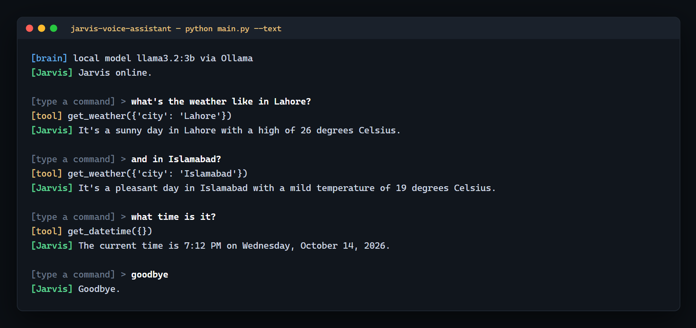

# Jarvis: a voice assistant with an LLM agent brain

Press Enter, speak, and it acts: opens sites, plays music, finds files, tells you
the time, the weather or the news. Speech-to-text and the default brain both run
**locally**, so it works without an API key or a cloud bill.


<sub>A real session in `--text` mode with llama3.2:3b. Note the follow-up "and in Islamabad?": the agent keeps the conversation and calls the tool again.</sub>

```
your voice ──► listen.py ──► brain.py ──► speak.py ──► you hear a reply
              (mic + Whisper)  (LLM picks     (offline TTS)
                                 a tool)
                                    │
                                    ▼
                                tools.py  (websites, YouTube, local media,
                                           files, time, weather, news)
```

## How it works

- **listen.py** records until you stop talking, then transcribes with
  [faster-whisper](https://github.com/SYSTRAN/faster-whisper) on the CPU. It gives up
  if you don't start talking within a few seconds and filters out non-speech, so
  silence doesn't turn into phantom commands.
- **brain.py** runs an agent loop: it sends the conversation and the tool schemas to an
  LLM, runs any tools the model asks for, feeds the results back, and repeats (capped
  at 4 rounds) until the model gives a spoken reply. Old turns are trimmed so long
  sessions never overflow the model's context.
- Two interchangeable backends share the same tools:
  - `brain_ollama.py`: a local open model through [Ollama](https://ollama.com) (default)
  - `brain_claude.py`: Anthropic's Claude API (faster, better at choosing tools)
- **tools.py** holds the capabilities. Each is a plain function plus a JSON schema.
- **speak.py** reads replies aloud with pyttsx3 (offline).
- **config.py** has every setting in one place.

## Setup

1. **Python 3.10+**, in a virtual environment:
   ```bash
   python -m venv .venv
   .venv\Scripts\activate          # macOS/Linux: source .venv/bin/activate
   pip install -r requirements.txt
   ```
   Linux needs `sudo apt install espeak libportaudio2` for voice output and the mic.

2. **Pick a brain.**
   - **Local (default, free):** install [Ollama](https://ollama.com), keep it running, then
     ```bash
     ollama pull llama3.2:3b         # or: python pull_model.py
     ```
     Any tool-capable model works; set `OLLAMA_MODEL` in `config.py`
     (`qwen2.5:7b` picks tools more reliably if your machine can run it).
   - **Claude:** set your key and switch the brain:
     ```bash
     setx ANTHROPIC_API_KEY "sk-ant-..."   # macOS/Linux: export ANTHROPIC_API_KEY=...
     setx JARVIS_BRAIN claude              # or set BRAIN = "claude" in config.py
     ```

3. *(Optional)* News headlines need a free key from [newsapi.org](https://newsapi.org),
   set as `NEWSAPI_KEY`. Weather uses [Open-Meteo](https://open-meteo.com) and needs no key.

## Run

```bash
python main.py           # press Enter and speak, or type a command and press Enter
python main.py --text    # keyboard only: no microphone, replies are printed
```

The first voice run downloads the Whisper model (about 150 MB) once.

Try: *"open github dot com"*, *"play lofi hip hop on youtube"*, *"find my resume"*,
*"what's the weather in Lahore"*, *"what time is it"*, *"goodbye"*.

If something isn't ready, Jarvis says what to fix at startup: Ollama not running,
model not downloaded, or API key missing.

## Adding a capability

Three steps in `tools.py`:

1. Write a function that does the thing and returns a short status string.
2. Describe it with `_schema(name, description, properties, required)`.
3. Add both to the `TOOLS` list.

Both brains pick it up automatically. Keep descriptions clear: that text is how the
model decides when to call the tool.

## Upgrade ideas

- **Wake word** ("Hey Jarvis") instead of pressing Enter: `openWakeWord` (free) or
  Picovoice Porcupine, then call `listen.listen()` after it fires.
- **Nicer voice**: replace the body of `speak.say()` with Piper (local) or ElevenLabs (API).
- **Faster replies**: Whisper `tiny.en`, and a GPU (`STT_DEVICE = "cuda"`).

## Safety: read before adding powerful tools

Every tool here only reads, opens or plays. The moment you add something
**irreversible** (deleting files, sending email, spending money), treat the tool list
as a security boundary:

- Only expose actions you're comfortable letting an LLM trigger from a misheard sentence.
- Gate destructive actions behind a spoken confirmation before doing them.
- Prefer narrow tools ("empty the downloads trash") over broad ones ("run this shell command").

The assistant is only ever as safe as the least safe tool you give it.

## Project structure

```
main.py           entry point: listen -> think -> speak loop, --text mode
brain.py          picks the backend, runs tools, trims history
brain_ollama.py   local brain (Ollama)
brain_claude.py   cloud brain (Anthropic API)
tools.py          tool functions + schemas
listen.py         microphone capture + Whisper speech-to-text
speak.py          text-to-speech
config.py         all settings
pull_model.py     downloads the Ollama model through the Python client
```
